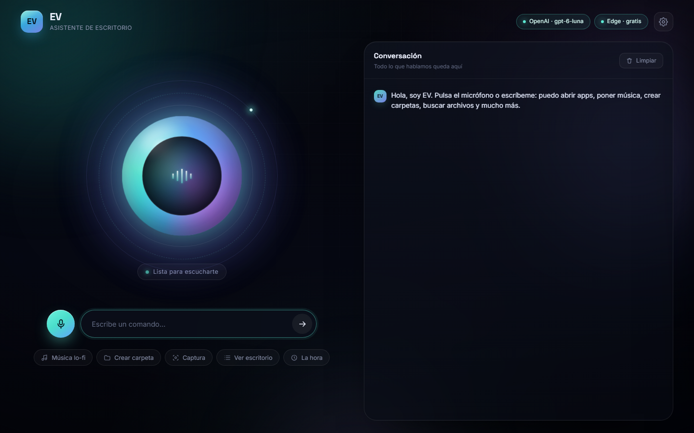
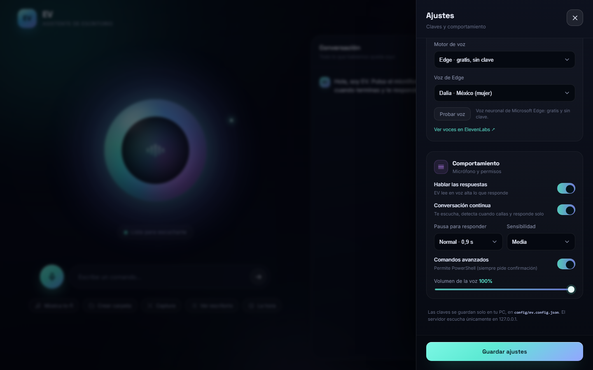
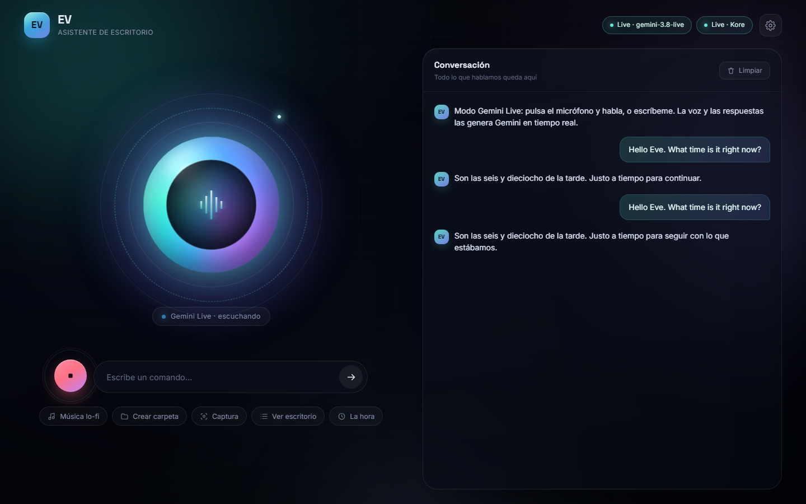
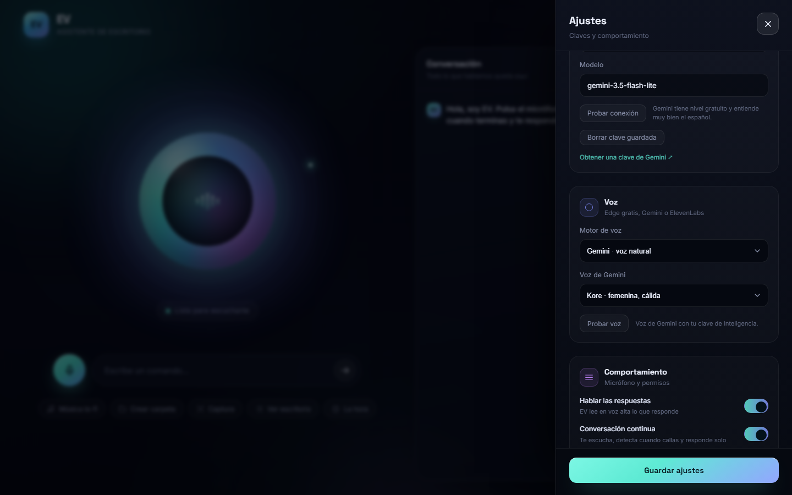
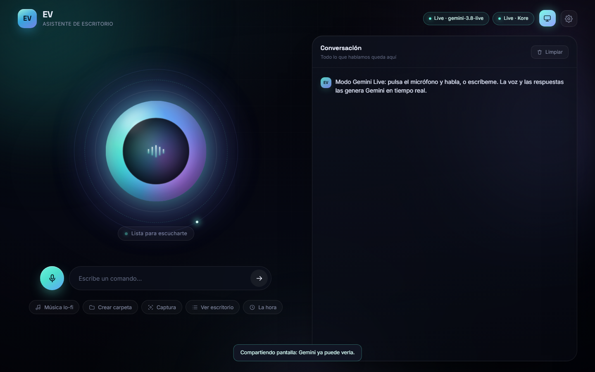

# EV · Asistente de escritorio

EV es una inteligencia artificial local para Windows que escucha tu micrófono, responde con voz y **hace cosas en tu PC**: abre aplicaciones, reproduce videos, crea carpetas, busca archivos, controla el volumen, toma capturas y más.

- **Respuestas:** OpenAI, Google Gemini, Anthropic Claude o cualquier API compatible con OpenAI (OpenRouter, Groq, DeepSeek, Ollama…).
- **Voz:** Microsoft Edge **gratis y sin clave** (por defecto), ElevenLabs opcional o la voz del navegador.
- **Oído:** conversación manos libres con detección de voz y **Whisper local** (gratis y privado).
- **Acciones:** 45 herramientas reales sobre Windows, con confirmación para lo delicado.
- **Pantalla:** mira lo que hay en tu pantalla, encuentra campos/botones y hace clic o escribe en ellos. En Gemini Live puedes **compartir pantalla en directo**.
- **Apps y multimedia:** encuentra programas por accesos directos, menú Inicio o registro, y reproduce YouTube de verdad (no solo busca).
- **Interfaz:** orb reactivo, chat, ajustes y atajos de teclado.



---

## 1. Arrancar

Requisitos: **Windows 10/11**, **Node.js 18 o superior** y un micrófono.

1. Abre la carpeta `EV`.
2. Doble clic en **`start.bat`**.
3. La primera vez instala las dependencias y abre `http://127.0.0.1:4173` en tu navegador.
4. Acepta el permiso de micrófono cuando el navegador lo pida.

Para apagar a EV, cierra la ventana negra de la consola.

> Funciona en cualquier navegador moderno (Chrome, Edge, Brave o Firefox): EV no depende del dictado del navegador, usa su propio detector de voz.

### Atajos

| Acción | Atajo |
| --- | --- |
| Empezar / parar la conversación | `Ctrl` + `Espacio` o el botón del micrófono |
| Enviar comando escrito | `Enter` |
| Cerrar ajustes / cancelar | `Esc` |

### Conversación continua (manos libres)

1. Pulsa el micrófono **una vez**: se pone rojo y EV empieza a escuchar.
2. Habla con normalidad. EV detecta cuándo empiezas y **cuándo callas**.
3. Al hacer una pausa (0,9 s por defecto) transcribe lo que dijiste y te responde en voz alta.
4. Mientras habla deja de escuchar (para no oírse a sí mismo) y, al terminar, **vuelve a escucharte solo**.
5. Pulsa el micrófono otra vez para parar.

En Ajustes → **Comportamiento** puedes cambiar:

| Ajuste | Opciones |
| --- | --- |
| **Pausa para responder** | Rápida (0,6 s) · Normal (0,9 s) · Pausada (1,4 s) |
| **Sensibilidad** | Alta · Media · Baja (si hay mucho ruido de fondo, baja) |
| **Conversación continua** | Desactívalo para volver al modo pulsar-hablar-pulsar |



La transcripción corre en **tu PC con Whisper** (`server/stt.js`): no gasta créditos de OpenAI, funciona sin conexión una vez descargado el modelo y tu voz no sale de casa.

---

## 2. Conectar la inteligencia y la voz

Abre el engranaje (arriba a la derecha). En **Inteligencia** eliges qué IA responde:


| Proveedor | Clave | Nivel gratuito | Modelos de ejemplo |
| --- | --- | --- | --- |
| **OpenAI** | https://platform.openai.com/api-keys | Algunos modelos tienen cupo diario | `gpt-4o-mini`, `gpt-4o`, `gpt-5`, `gpt-6-luna` |
| **Google Gemini** | https://aistudio.google.com/apikey | Sí, generoso | `gemini-2.5-flash`, `gemini-2.5-pro` |
| **Google Gemini Live** | La misma clave de Gemini | Cuota del plan | `gemini-3.8-live` · chat **y voz en tiempo real** |
| **Anthropic Claude** | https://console.anthropic.com/settings/keys | No (requiere crédito) | `claude-sonnet-4-5`, `claude-haiku-4-5` |
| **Compatible OpenAI** | Según el servicio | Depende | OpenRouter, Groq, DeepSeek, Mistral, Ollama… |

1. Elige el proveedor.
2. Pega su clave (cada proveedor guarda la suya, así puedes cambiar sin volver a escribirla).
3. Elige el modelo (la lista sugiere algunos; puedes escribir cualquier otro).
4. Pulsa **Probar conexión**: te dice si la clave y el modelo responden.

Con *Compatible OpenAI* rellena también la **URL base**:

| Servicio | URL base |
| --- | --- |
| OpenRouter | `https://openrouter.ai/api/v1` |
| Groq | `https://api.groq.com/openai/v1` |
| DeepSeek | `https://api.deepseek.com/v1` |
| Mistral | `https://api.mistral.ai/v1` |
| Ollama (local) | `http://127.0.0.1:11434/v1` |
| LM Studio (local) | `http://127.0.0.1:1234/v1` |

### Gemini Live (voz en tiempo real)

`gemini-3.8-live` no usa el endpoint normal de chat: habla por el **Live API** (WebSocket `bidiGenerateContent`). EV monta un puente en `server/live.js`, así que funciona igual desde la interfaz:

1. Elige **Google Gemini Live** como proveedor y el modelo `gemini-3.8-live`.
2. Pulsa el micrófono **una vez**. EV abre la sesión y empieza a enviar tu voz en streaming.
3. Gemini escucha, detecta cuándo hablas y **responde con su propia voz** (sin pasar por Edge ni ElevenLabs).
4. Si hablas encima de su respuesta, la interrumpe (barge-in).
5. Las herramientas funcionan igual: puede abrir apps, crear carpetas, etc. Las acciones peligrosas **preguntan antes** con el mismo modal.
6. También puedes **escribir** en el cuadro de texto: la respuesta llega igualmente en voz y con transcripción.



Detalles:

- La voz se elige con **Voz de Gemini Live** (Kore, Aoede, Puck…). El «Motor de voz» no se usa en este modo.
- La transcripción de lo que dices y de lo que responde aparece en el chat.
- Al parar el micrófono se cierra la sesión; al volver a pulsarlo se abre una nueva.
- Funciona con cualquier modelo Live de tu cuenta (`gemini-3.8-live-extended-thinking`, `gemini-3.1-flash-live-preview`…).
- Consume cuota del Live API de Google. Si se agota, cambia a **Google Gemini** (texto) + **Edge** (voz).

Las claves se guardan **solo en tu PC**, en `config/ev.config.json`, y el servidor escucha únicamente en `127.0.0.1`.

### Cuatro formas de tener voz

| Motor | Qué necesitas | Calidad |
| --- | --- | --- |
| **Edge** (por defecto) | Nada: internet y listo | Neuronales de Microsoft, muy naturales, 9 voces en español |
| **Gemini** | Tu clave de Gemini (la misma de Inteligencia) | Voces de Google, muy naturales; es un modelo de vista previa y se factura por uso |
| **ElevenLabs** | Clave + plan que permita la voz elegida | La más expresiva |
| **Navegador** | Nada | Voces de Windows, más robóticas |

En Ajustes → **Motor de voz** eliges entre *Automático*, *Edge*, *Gemini*, *ElevenLabs* o *Navegador*. Con *Gemini* eliges además entre sus voces (Kore, Aoede, Leda, Puck, Charon…). Si Gemini falla o se queda sin cuota, EV sigue hablando con Edge y te avisa.

> En **Gemini Live** la voz la genera el propio modelo en tiempo real: el motor de voz no interviene.



> La transcripción de tu voz es **local** (Whisper en tu PC), así que no consume créditos de OpenAI ni envía audio a ningún servidor. Solo el texto llega al proveedor de IA elegido.

> **Sobre el error 402 de ElevenLabs** («Free users cannot use library voices»): las voces de la *Voice Library* solo están disponibles en planes de pago. En el plan gratuito funcionan las **voces predeterminadas** (Rachel, Adam, Bella, Antoni, George, Lily, Jessica…): están en la lista desplegable del campo *Voice ID*. Si prefieres no pagar nada, deja el motor en **Edge**.

También puedes usar un archivo `.env` (copia `.env.example` como `.env`):

```env
# IA (la que elijas; también se configura desde Ajustes)
OPENAI_API_KEY=sk-...
GEMINI_API_KEY=AIza...
ANTHROPIC_API_KEY=sk-ant-...

# Voz
ELEVENLABS_API_KEY=...
ELEVENLABS_VOICE_ID=21m00Tcm4TlvDq8ikWAM
```

### Modos de funcionamiento

| Sin claves | Con OpenAI, Gemini o Claude | Con voz de ElevenLabs |
| --- | --- | --- |
| Comandos básicos por reglas locales, voz de Edge | Conversación libre + todas las acciones, voz de Edge | Experiencia completa con voz propia |

---

## 3. Qué puede hacer

Prueba a decirlo en voz alta:

- «Pon música de Bad Bunny en Spotify» · «Reproduce Bohemian Rhapsody» (reproduce en segundo plano sin abrir ventanas)
- «¿Qué tengo en la agenda hoy?» · «¿Cuáles son mis próximas reuniones?» (Google Calendar)
- «Agenda una reunión mañana a las 5 con el equipo» · «Crea una cita en el calendario»
- «Abre Chrome» · «Abre Spotify» · «Abre Discord» (aunque no estén en el PATH)
- «Busca la app Captura» (si no sabes el nombre exacto)
- «Reproduce música lo-fi» · «Pon lofi hip hop» (reproduce el vídeo, no la búsqueda)
- «Reproduce tal canción» (busca primero archivos en Música, Vídeos y Descargas)
- «Crea una carpeta llamada Proyectos en el escritorio»
- «Crea una nota llamada ideas con el texto comprar café»
- «¿Qué hay en el escritorio?»
- «Busca el archivo presupuesto»
- «Copia el archivo notas.txt a Documentos» · «Renombra informe a informe-final»
- «Comprime la carpeta Proyectos» · «Descomprime backup.zip»
- «Sube el volumen» · «Silencia» · «Pausa la música» · «Siguiente canción»
- «Toma una captura de pantalla»
- «¿Cuánta RAM tengo?» · «¿Qué hora es?» · «¿Cuánto espacio libre queda?»
- «¿Qué ventanas tengo abiertas?» · «Minimiza Spotify» · «Cierra Discord»
- «¿Cuál es mi IP?» · «Qué tiempo hace en Madrid»
- «Escribe hola mundo» · «Pulsa Ctrl+C»
- «Descarga https://…» · «Crea un acceso directo a Spotify»
- «Copia hola mundo al portapapeles»
- «Abre la configuración de bluetooth»
- «Vacía la papelera» · «Bloquea el equipo» · «Apaga el equipo» (piden confirmación)

### Control del PC

Las 48 herramientas cubren: Spotify en segundo plano, Google Calendar (agenda y citas), aplicaciones, web, YouTube y medios locales, archivos y carpetas, copiar/mover/renombrar, ZIP, lectura de archivos, discos, procesos, ventanas, teclado, red, clima, descargas, accesos directos, brillo, volumen, multimedia, capturas, portapapeles, energía, ajustes de Windows y **control de pantalla**.

- **Spotify:** reproduce canciones, artistas, géneros o álbumes en segundo plano sin robar el foco ni abrir ventanas molestas. Conecta tu cuenta en **Ajustes → Spotify → Conectar con Spotify** para cambiar de canción al instante mediante la API oficial; sin conectar, usa la búsqueda y el motor local de Windows.
- **Google Calendar:** permite consultar los próximos eventos y programar nuevas citas o recordatorios directamente por voz mediante la API oficial con OAuth o acceso web instantáneo.

### Control de pantalla y visión

EV puede mirar tu pantalla y actuar sobre ella:

| Herramienta | Qué hace |
| --- | --- |
| `look_at_screen` | Mira la pantalla y responde (leer un campo, describir una ventana) |
| `find_on_screen` | Localiza un elemento y devuelve sus coordenadas |
| `click_on_screen` | Busca un elemento por descripción y hace clic |
| `type_into` | Busca un campo, hace clic y escribe el texto |
| `mouse_click` · `scroll` | Clic y desplazamiento puntual |
| `auto_scroll` · `stop_actions` | Desplazamiento lento continuo y parada |

**Compartir pantalla en vivo:** en Gemini Live pulsa el icono de **monitor** (arriba a la derecha). EV envía ~1 fotograma por segundo al modelo, que ve los cambios y puede comentarlos o actuar. Vuelve a pulsarlo para dejar de compartir.



Ejemplos reales:

- «Mira la pantalla y dime qué ventana tengo abierta.»
- «Haz scroll despacio por YouTube… para. Pon el vídeo del título que empieza por “lofi”.»
- «Rellena el campo de email con mi correo.» Después deja que **tú escribas la contraseña**.
- «Haz clic en el botón de iniciar sesión.»

**Seguridad del control de pantalla:**

- Pulsa **Esc** para detener el desplazamiento y dejar de compartir.
- Mientras usas visión o compartes pantalla, las capturas se envían a Gemini. No compartas ventanas con datos sensibles.
- No dictes contraseñas: pide a EV que enfoque el campo y escríbela tú.
- Puedes desactivar los clics/teclado automáticos con `allowScreenControl: false` en `config/ev.config.json` o `EV_ALLOW_SCREEN_CONTROL=0` en `.env`.
- La visión usa `gemini-3.5-flash-lite` (configurable con `GEMINI_VISION_MODEL`); si se agota la cuota, te avisa y puedes cambiar de modelo.

### Seguridad

- Las acciones destructivas (apagar, reiniciar, borrar, PowerShell) **preguntan antes** en un modal.
- Los borrados van a la **Papelera de reciclaje**, no se destruyen.
- PowerShell avanzado está **desactivado** por defecto; se activa en Ajustes y siempre pide confirmación.
- El control de pantalla (clic/teclado) se puede desactivar y se detiene con **Esc**.
- Nada se ejecuta en segundo plano: EV solo actúa cuando tú hablas o escribes.

---

## 4. Estructura

```
EV/
├─ start.bat              Arranca EV e instala dependencias la primera vez
├─ bin/yt-dlp.exe         Busca y resuelve vídeos de YouTube
├─ server/
│  ├─ index.js            Servidor Express + API (/api/chat, /api/tts, /api/transcribe)
│  ├─ brain.js            Proveedores de IA (OpenAI, Gemini, Claude) + motor local
│  ├─ tools.js            Las 45 acciones sobre Windows
│  ├─ vision.js           Captura de pantalla, visión y control de ratón/teclado
│  ├─ tts.js              Voz: Edge gratis, ElevenLabs y caché
│  ├─ stt.js              Oído: Whisper local (gratis, privado)
│  ├─ live.js             Puente WebSocket con Gemini Live (voz y pantalla en tiempo real)
│  ├─ config.js           Ajustes persistidos y carpetas del sistema
│  └─ scripts/            PowerShell (apps, captura, ratón, ventanas, multimedia, papelera)
├─ public/
│  ├─ index.html          Interfaz
│  ├─ styles.css          Diseño (orb, chat, ajustes)
│  └─ app.js              Micrófono, detector de voz, voz, chat y ajustes
├─ models/                Modelo de Whisper (se descarga la primera vez)
└─ config/                Se crea al guardar ajustes (ignorado por git)
```

### Cómo fluye un comando

1. El detector de voz nota que hablas y graba desde medio segundo antes.
2. Al callar, **Whisper local** convierte el audio en texto (1–4 s según la frase).
3. El cerebro envía el texto al proveedor de IA elegido (OpenAI, Gemini, Claude o compatible) con la lista de herramientas.
4. La IA elige la herramienta y sus argumentos.
5. EV ejecuta la acción en Windows y devuelve el resultado.
6. La respuesta se muestra en el chat y se lee con la voz configurada (Edge o ElevenLabs).

---

## 5. Problemas comunes

| Síntoma | Solución |
| --- | --- |
| «No pude conectar con el servidor» | Cierra la consola y vuelve a abrir `start.bat`. |
| El micrófono no responde | Revisa el candado de la barra de direcciones y concede el permiso. |
| La primera vez tarda en oírte | Está descargando el modelo de Whisper (unos 300 MB). Espera a que la consola diga «Transcripción local lista». |
| No me transcribe o tarda mucho | El modelo tarda 1–4 s por frase en CPU. Si va lento, usa el modelo rápido: `EV_STT_MODEL=onnx-community/whisper-base` en `.env`. |
| Me corta antes de terminar | Sube la **Pausa para responder** a 1,4 s en Ajustes. |
| Se activa con el ruido de fondo | Baja la **Sensibilidad** en Ajustes (opción Baja). |
| Habla antes de que termine | EV deja de escuchar mientras habla y vuelve después; si te interrumpe, espera a que acabe la frase. |
| No hay voz de ElevenLabs | Comprueba la clave y el **Voice ID**. Si falla, EV sigue con Edge y te avisa. |
| Error 402 de ElevenLabs | Esa voz es de la biblioteca y exige plan de pago. Elige una predeterminada de la lista o pon el motor en **Edge**. |
| La voz de Edge no suena | Necesita conexión a internet. Comprueba la red o elige «Voz del navegador». |
| La voz de Gemini falla | Comprueba que tu clave de Gemini está en Inteligencia y que el modelo TTS está disponible en tu cuenta. EV cae a Edge automáticamente y te lo dice. |
| Gemini Live no conecta | Pulsa **Probar conexión**: suele ser la clave o la cuota del Live API. El modelo se escribe como `gemini-3.8-live`. |
| En modo Live no se oye | Revisa el volumen y el permiso del micrófono. La sesión se abre al pulsar el micrófono y se cierra al pulsarlo otra vez. |
| Live se corta solo | Puede ser cuota agotada o límite de duración de la sesión. Vuelve a pulsar el micrófono para abrir otra. |
| La voz empieza cortada, como con un fade | EV mantiene el audio caliente y añade un silencio inicial de 0,4 s para que el dispositivo arranque. Si usas un altavoz Bluetooth lento, sube `ttsLeadMs` en `config/ev.config.json` (o `EV_TTS_LEAD_MS`) a 700–1000. |
| El puerto está ocupado | EV usa el siguiente libre automáticamente (4174, 4175…). Mira la URL en la consola. |
| «La clave de OpenAI no es válida» | Vuelve a pegarla en Ajustes; debe empezar por `sk-`. |
| «Está limitando las peticiones» | Cupo alcanzado en ese proveedor (p. ej. OpenAI limita `gpt-6-luna` a 50 peticiones al día). Cambia de modelo o de proveedor en Ajustes; Gemini y OpenRouter tienen planes gratuitos. |
| Gemini/Claude no responden | Pulsa **Probar conexión** en Ajustes y revisa el mensaje; suele ser la clave o el nombre del modelo. |
| Apagar/reiniciar no funciona | Windows puede requerir permisos de administrador para `shutdown` en algunos equipos. |
| Una app no se abre | Ahora se buscan accesos directos, menú Inicio, App Paths y programas instalados. Si aun así falla, prueba «busca apps <nombre>» y usa el nombre que aparezca. |
| La música no empieza sola | EV abre el vídeo concreto de YouTube; si el navegador bloquea el autoplay, pulsa play. En Spotify, conecta tu cuenta en **Ajustes → Spotify → Conectar con Spotify** para que EV cambie de canción por la API sin abrir la ventana. Sin conectar, Spotify solo abre la página/búsqueda de la canción cuando ya hay otra sonando. |
| La visión no encuentra un campo | Describe el campo con más detalle («el campo blanco de email debajo del título») y asegúrate de que la ventana está visible. Si Gemini está saturado o sin cuota, lo indica. |
| Compartir pantalla no aparece | El botón de monitor solo funciona con **Gemini Live**. Si no ves la pantalla en el modelo, vuelve a pulsarlo; el navegador pedirá qué compartir. |
| yt-dlp falla o no encuentra vídeos | Comprueba `bin/yt-dlp.exe` y tu conexión. Si falla, EV abre la búsqueda de YouTube como respaldo. |

---

## 6. Personalizar

- **Voz:** cambia el `Voice ID` en Ajustes (ElevenLabs multilingüe).
- **Oído:** `EV_STT_MODEL` en `.env` elige el modelo de Whisper. Por defecto `onnx-community/whisper-small` (más preciso); `onnx-community/whisper-base` es más rápido y ligero.
- **Modelo:** el que quieras de cada proveedor. EV detecta solo si el modelo necesita `max_completion_tokens`, `reasoning_effort` o no admite `temperature`, así que no hay que tocar nada.
- **Otros proveedores:** usa *Compatible OpenAI* con su URL base (`OPENAI_BASE_URL`/`EV_COMPATIBLE_BASE_URL` en `.env`).
- **Colores:** variables al inicio de `public/styles.css` (`--teal`, `--indigo`, `--violet`).
- **Herramientas nuevas:** añade la definición y el handler en `server/tools.js`; el modelo la verá automáticamente.

Hecho para funcionar en local, sin cuentas intermedias ni telemetría.
